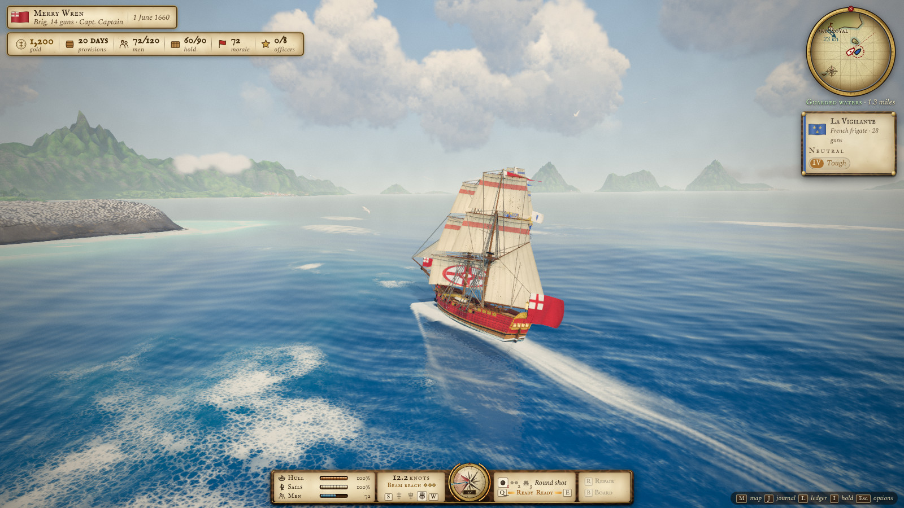
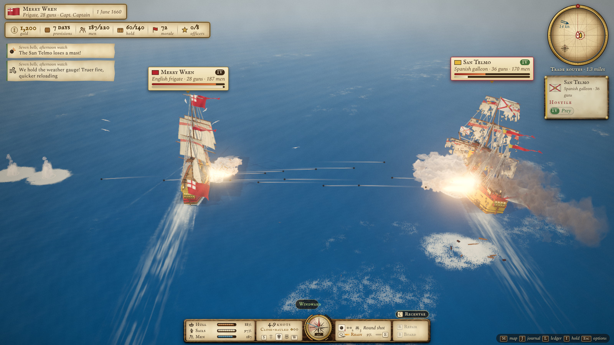
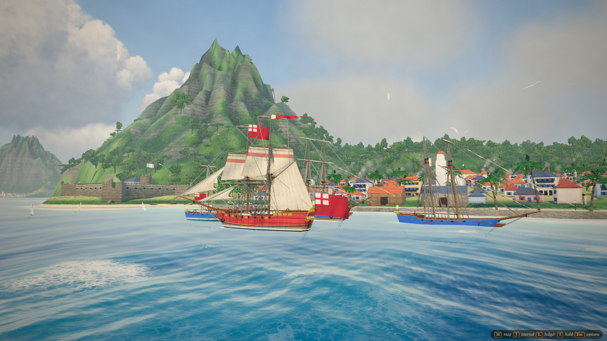
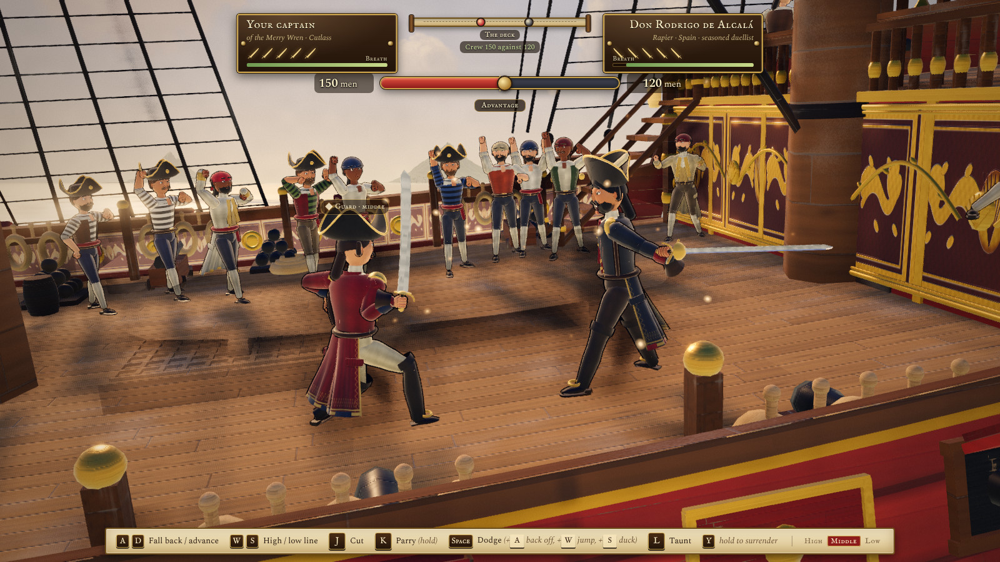
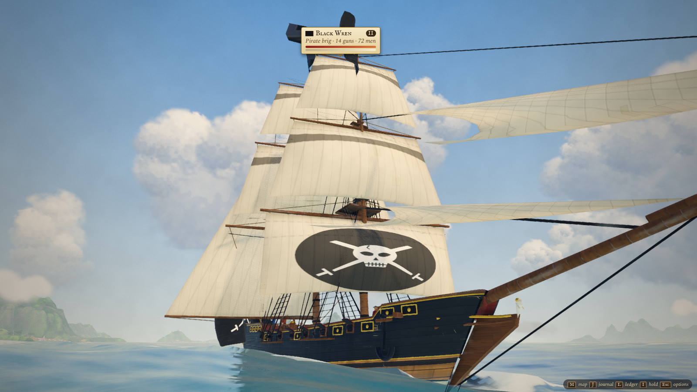

# Tides of Fortune

*[Read in English](README.md)*

Un jeu de pirates et de corsaires en monde ouvert, dans le navigateur, dans les Caraïbes du XVIIe siècle :
navigation, combats navals, abordages et duels à l'épée, ports, commerce, missions de gouverneur et toute une
carrière en mer. Sur ordinateur, au clavier et à la souris. Le jeu est en anglais.

**Jouer :** https://tides-of-fortune.fr/

https://github.com/user-attachments/assets/08863135-3381-42e2-ba97-17952717541b

*Bande-annonce filmée dans le jeu lui-même (qualité Ultra), avec ses propres sons et sa musique générés par le code.*



## Genèse du projet

Avez-vous rêvé de devenir un pirate ? Moi oui. Symbole d'aventure, de liberté, de soleil et d'une époque lointaine,
le milieu de la piraterie apporte un univers riche en histoires qui fascine.

En tant que grand fan de jeux des années 2000, j'ai notamment joué à *Sid Meier's Pirates!*, un jeu qui a fasciné
de nombreux capitaines dans cet univers très complet. Le temps est passé et les graphismes sont restés dans leur
époque, alors pourquoi ne pas donner un nouvel élan à ce genre de jeu en s'appuyant sur les dernières avancées de
l'IA ?

L'objectif du projet est double :

1. donner un nouveau souffle aux graphismes de ce genre de jeu, avec un univers complet et jouable ;
2. adopter une architecture technique légère qui permette de le rendre accessible au plus grand nombre.

*Tides of Fortune* est un jeu original : aucun nom, visuel, musique, texte ou interface n'est repris de *Pirates!*
ni d'un autre jeu.

## Fil conducteur

Le jeu est avant tout une simulation de navigation. À bord de votre navire, vous allez parcourir une partie de la
mer des Caraïbes. Vous y rencontrerez de nombreux marins des principales nations de l'époque (Espagne, Angleterre,
France, Pays-Bas), des pirates et des pêcheurs neutres. Vous pouvez mettre pied à terre dans des ports.

La navigation et le système de combats marins sont unifiés : lorsqu'un combat se déclenche, tout bateau peut le
rejoindre, ce qui peut mener à des joutes entre plusieurs factions… attention aux renforts ! Les tirs se font une
fois tous les canons chargés sur le bord souhaité. Petite particularité de ce jeu, la précision des tirs doit être
calculée avec soin pour que vos boulets ne finissent pas à l'eau.

https://github.com/user-attachments/assets/3d364e38-482e-4c49-8b12-846ec9e5091a

*Une partie avec l'interface complète : réglage des voiles, combat contre un galion espagnol (boulets ronds puis
ramés), abordage et duel à l'épée sur le pont. Les touches sont affichées pour un clavier QWERTY.*

## L'univers : bateaux, factions, journées, commerce

Lors de vos aventures, vous croiserez de nombreux modèles de bateaux appartenant à différentes classes (de I à V),
qui vous permettent de repérer leur puissance estimée. Chaque bateau a des propriétés qui lui sont propres : nombre
de canons, équipage, capacité de la cale, vitesse, maniabilité, tirant d'eau et solidité de la coque. Ces capacités
peuvent bénéficier d'améliorations au chantier naval : canons plus lourds, bordé doublé, cale approfondie,
doublage de cuivre, toile fine, hamacs supplémentaires.

Dans le jeu, le temps avance et les journées passent. Cela permet d'admirer de magnifiques levers et couchers de
soleil, mais attention à vos provisions, qui sont consommées par votre équipage. Le temps est également compté pour
accomplir les missions ponctuelles que vous pouvez accepter dans les ports.

En chiffres :

- **27 types de navires** en 9 familles, du lougre au trois-ponts ;
- **36 îles**, **14 ports** sous cinq pavillons (espagnol, anglais, français, hollandais et repaires de pirates)
  et **6 villages de pêcheurs** ;
- **16 marchandises** dont les prix suivent l'offre et la demande, ville par ville ;
- des nations qui se font la guerre, signent la paix ou s'allient au fil des jours, des convois et des galions au
  trésor, des capitaines pirates classés dans un Top 10, des cartes au trésor à reconstituer ;
- une carrière avec des grades, des terres et un score final quand votre capitaine prend sa retraite.

Loin du large, vous pouvez aussi commercer, recruter et radouber au port, aborder un navire et affronter son
capitaine l'épée à la main, prendre une ville d'assaut avec votre équipage, ou déjouer de nuit les gardes d'une
ville hostile.

## En images

<table>
  <tr>
    <td width="50%"><br><sub>Échange de bordées avec un galion espagnol</sub></td>
    <td width="50%"><br><sub>Fort Royal, un port français</sub></td>
  </tr>
  <tr>
    <td width="50%"><br><sub>Duel à l'épée sur le pont d'un galion espagnol</sub></td>
    <td width="50%"><br><sub>Un brick pirate toutes voiles dehors</sub></td>
  </tr>
</table>

*Captures prises dans le jeu, en préréglage Ultra.*

## Volet technique

### Une architecture légère

- **Une seule page, rien à installer.** Le jeu entier tient dans un fichier HTML d'environ 2 Mo (700 ko
  compressé). Il tourne dans le navigateur avec WebGL 2, sans module, sans serveur et sans compte.
- **Aucun fichier de ressources.** Navires, voiles et gréement, îles, villes, personnages, textures, shaders,
  musique et bruitages sont tous générés par le code au chargement. La seule ressource externe est la feuille de
  polices de Google Fonts.
- **Peu de briques.** [three.js](https://threejs.org) r186 pour le rendu 3D et [Vite](https://vite.dev) 8 pour la
  construction, des modules JavaScript simples, aucun framework. Environ 150 fichiers JavaScript et 34 000 lignes
  de code.
- **Les sauvegardes** vont dans le stockage local du navigateur : automatiquement en quittant un port et toutes les
  deux minutes en mer.

### Rendu

- **Océan** : 12 vagues de Gerstner calculées sur le GPU, avec une copie exacte sur le processeur. Les navires
  flottent, gîtent et tanguent sur la surface même que vous voyez. Anneaux de détail autour de la caméra, mer plus
  calme sur les hauts-fonds, sillages d'écume dessinés dans une texture.
- **Ciel et météo** : un cycle jour-nuit complet avec levers, couchers et nuits étoilées, un éclairage d'ambiance
  qui suit le ciel, des nuages éclairés par-dessous au crépuscule, des grains et des tempêtes qui se déplacent sur
  la mer, un vent qui tourne lentement.
- **Îles et villes** : relief cuit en parallèle par des Web Workers pendant le chargement, végétation instanciée,
  villes et forts procéduraux découpés en blocs de 60 m pour que seule la partie utile soit dessinée dans les
  ombres.
- **Navires** : 27 types tirés de 6 plans de base paramétriques. Textures de bordé peintes pour chaque type, usure
  et brûlures, version allégée de chaque coque au-delà d'environ 200 m.
- **Personnages** : figures procédurales articulées pour les duels, la foule et les figurants des ports, visages
  tirés au sort, contour à l'encre. Les portraits du port sont rendus en 3D, et les tableaux de la salle du
  gouverneur passent par un filtre de Kuwahara pour paraître peints.
- **Rendu peint** : une chaîne HDR avec rayons de soleil, halo lumineux (bloom), tone mapping ACES et étalonnage
  (grain de toile, vignettage, virage des couleurs), puis anticrénelage FXAA, ou SMAA et occlusion ambiante (GTAO)
  en Ultra.

### Performances

- Trois préréglages graphiques (Performance, Standard, Ultra) et une résolution dynamique qui ajuste la taille de
  l'image chaque seconde pour garder un rythme d'images stable.
- La cible est de 60 images par seconde en 1080p sur un GPU de portable milieu de gamme, sous 400 appels de dessin.
  En mer, le préréglage Standard en fait 100 à 170 pour 0,4 à 0,6 million de triangles.
- Les shaders sont compilés à l'avance, en parallèle quand le GPU le permet : un port, un duel ou une bataille
  s'ouvrent sans à-coup.

### Simulation

- **Navigation** : courbes de vitesse par gréement (carré, aurique ou mixte) et par allure, dérive, gîte, tirant
  d'eau et hauts-fonds. Volontairement arcade : la réactivité passe avant le réalisme.
- **Artillerie** : chaque boulet est un vrai projectile. Les canons se pointent seuls sur l'ennemi le plus proche
  dans leur secteur et anticipent sa route, mais le roulis du navire, la distance, la dispersion de chaque
  munition et le fait de tenir le vent décident du point de chute. Le boulet rond défonce la coque, le boulet ramé
  déchire les voiles, la mitraille fauche l'équipage. Les mâts tombent, les navires amènent leurs couleurs, les
  soutes à poudre explosent.
- **IA** : chaque rôle a son tempérament. Les marchands fuient et se rendent, patrouilles et chasseurs se battent
  pour le vent, les pirates foncent, les escortes défendent leur convoi, et tous contournent les tempêtes.
- **Un monde vivant** : diplomatie, événements des villes (croissance, épidémies, raids), marchés et convois sont
  tirés jour après jour. La mer est découpée en trois niveaux de danger, des eaux gardées du port de départ aux mers
  périlleuses.
- **Duels, attaques de villes et infiltration** reposent sur des simulations pures, séparées du rendu : un duel
  avec lignes d'attaque, parades et souffle, une bataille sur une grille de 48 × 32 cases tirée du relief de l'île
  avec recherche de chemin, des gardes avec un cône de vision et de vraies ombres portées où se cacher.
- **Audio** : synthétisé en direct avec la Web Audio API. Les mélodies sont générées à partir de graines dans les
  modes de chaque thème (mer, bataille, tempête, taverne de chaque nation…), cordes pincées par modélisation
  physique (Karplus–Strong).
- **Tous les claviers** : les touches sont lues par leur position physique et affichées avec les vraies lettres de
  votre disposition (W A S D en QWERTY, Z Q S D en AZERTY).

### Fait avec l'IA

Le jeu a été écrit avec Claude (Anthropic), au moyen de Claude Code, sous la direction de l'auteur. La méthode :

- chaque système passe **trois rondes de critique sévère** sur des captures fraîches, avec une note par axe, un
  verdict WIN/FAIL et une liste de corrections classée avant la ronde suivante ;
- une **bible artistique** fixe la direction (un livre d'aventure peint), la palette et le budget de performance ;
- **16 scènes vitrines** (`?shot=`) cadrent chaque système pour les captures, et **22 tests scénarisés**
  (Playwright et Node) jouent le jeu pour vérifier la navigation, le combat, les duels, les missions, l'économie,
  etc. ;
- des outils de performance mesurent les triangles et les appels de dessin de chaque système, les étapes du
  chargement et le coût de chaque transition.

## Lancer le jeu en local

Il faut [Node.js](https://nodejs.org) 20 ou plus récent (version LTS) et Git.

```sh
git clone https://github.com/silvestroz/tides-of-fortune.git
cd tides-of-fortune
npm install
npm run dev
```

Ouvrir ensuite **http://127.0.0.1:5173** dans Chrome ou Edge. Le rechargement à chaud est coupé : recharger la
page après une modification.

Sous Windows, si PowerShell refuse `npm` (« l'exécution de scripts est désactivée sur ce système »), lancer une
fois `Set-ExecutionPolicy -Scope CurrentUser RemoteSigned`, ou utiliser l'Invite de commandes (`cmd`).

### Construire un fichier unique

```sh
npm run build
```

Produit `dist/tides-of-fortune.html` (environ 2 Mo), un fichier autonome qui tourne sans serveur.

## Commandes

Les touches sont données selon leur place sur un clavier QWERTY. Le jeu lit la touche physique et affiche la
lettre de votre disposition à l'écran (en AZERTY, W A S D deviennent Z Q S D). La liste complète est dans
**Controls**, sur l'écran titre.

| En mer | Touches |
|---|---|
| Établir ou réduire la voilure | W / S |
| Barre | A / D |
| Bordée bâbord / tribord | Q / E |
| Tirer sur l'ennemi le plus proche | Espace |
| Boulet rond / ramé / mitraille | 1 / 2 / 3 |
| Aborder un ennemi affaibli bord à bord | B |
| Réparations d'urgence (en panne) | R |
| Cale : jeter des marchandises ou des canons | I |
| Amener les couleurs | X deux fois |
| Caméra · recentrer au combat | C |
| Accélérer le temps | T |
| Feu à volonté / cessez le feu (mode Assisted) | G |
| Entrer au port · accoster à un village · creuser au trésor | F |
| Attaquer une ville · organiser une attaque depuis un repaire | V |
| Carte / Registre / Journal | M / L / J |
| Pause et options | Échap |

| En duel | Touches |
|---|---|
| Reculer / avancer | A / D |
| Ligne haute / basse (aucune = milieu) | W / S |
| Frapper / parer (maintenir) | J / K |
| Esquiver (avec une direction : reculer, sauter, se baisser) | Espace |
| Provoquer / se rendre (maintenir) | L / Y |

L'attaque de ville se joue à la souris (choisir les troupes et leur donner des ordres) et avec W A S D pour la
caméra ; l'infiltration avec W A S D, Maj pour courir et Espace pour crocheter une serrure.

## Sauvegarde, temps et graphismes

- **Sauvegarde** automatique en quittant un port, après une prison, un naufrage ou une bataille, et toutes les deux
  minutes en mer hors combat. Échap → Save sauvegarde à la main en mer. Une seule partie par navigateur.
- **Temps** : un jour du calendrier est un cycle jour-nuit, soit quatre minutes réelles (T accélère les deux). Une
  carrière complète, du premier commandement à la retraite, dure 12 à 18 heures de jeu.
- **Graphismes** : Options → Graphics propose Performance, Standard et Ultra (appliqué au rechargement). F3 affiche
  la fréquence d'images et le coût du rendu.
- **Statistiques** : en production, le jeu compte quelques étapes anonymes (durée du chargement, premiers pas,
  fluidité, erreurs) sous forme de pages vues dans Vercel Web Analytics. Rien n'est envoyé avec Do Not Track ou
  Global Privacy Control, et Options → Statistics les coupe.

## Paramètres d'URL

| Paramètre | Effet |
|---|---|
| `?quality=low` / `medium` / `high` / `ultra` | niveau graphique (par défaut `high`) |
| `?shot=<scène>` | ouvre une scène vitrine : `ocean`, `sky`, `weather`, `ships`, `islands`, `sailing`, `combat`, `hud`, `port`, `village`, `duel`, `worldmap`, `sealife`, `landbattle`, `sneak`, `overview` |
| `?tod=17.5` | heure du jour fixée |
| `?weather=clear` / `cloudy` / `storm` | météo fixée |
| `?sealife=dolphins` | fait apparaître la vie marine (`dolphins`, `whale`, `flyfish`, `turtle`, `ray`, `bait`) |
| `?start=<id de port>` | port de départ (par défaut Port Royal) |

## Organisation du code

| Dossier | Contenu |
|---|---|
| `src/core` | boucle de jeu, entrées, dispositions de clavier, post-traitement, niveaux de qualité |
| `src/world` | océan, ciel et météo, îles et relief, végétation, villes, vie marine |
| `src/ships` | modèles procéduraux des navires, physique de navigation, commandes du joueur, IA |
| `src/combat`, `src/fx` | bordées, dégâts, naufrages, effets visuels |
| `src/game` | ports, économie, carrière, missions, sauvegarde, abordage, duels, attaques de villes, infiltration |
| `src/data` | tables de réglage (types de navires, missions, zones, objets…) |
| `src/ui` | interface en mer, menus, écrans du port, carte du monde |
| `src/audio` | son et musique procéduraux (Web Audio) |
| `src/shots` | scènes vitrines (`?shot=`) |
| `tools` | construction, captures, tests scénarisés, outils de performance |
| `docs` | bible artistique, protocole et rapports de critique |

Les tests scénarisés (`node tools/test-*.mjs`) et les outils de capture utilisent Playwright : lancer
`npx playwright install chromium` la première fois.

## Crédits

- Polices : [IM Fell English](https://fonts.google.com/specimen/IM+Fell+English) et IM Fell English SC d'Igino
  Marini, [Spectral](https://fonts.google.com/specimen/Spectral) de Production Type, toutes sous licence SIL Open
  Font License, servies par Google Fonts.
- [three.js](https://threejs.org) pour le rendu 3D, [Vite](https://vite.dev) pour la construction, la Web Audio API
  pour le son.

*Tides of Fortune* est un projet indépendant. Il n'est ni affilié aux créateurs ou aux éditeurs de *Sid Meier's
Pirates!*, ni approuvé par eux ; toutes les marques appartiennent à leurs propriétaires respectifs.

## Licence

Tides of Fortune est publié sous la [licence PolyForm Noncommercial 1.0.0](LICENSE.md). Vous pouvez jouer, étudier,
modifier et partager le jeu et son code pour tout usage non commercial : usage personnel, recherche, enseignement,
projets de loisir, associations et institutions publiques. Le vendre, ou l'utiliser dans un produit ou un service
commercial, demande une autorisation de l'auteur.

Les polices, three.js et les autres bibliothèques gardent leur propre licence.

Le texte de la licence (en anglais) fait foi.
