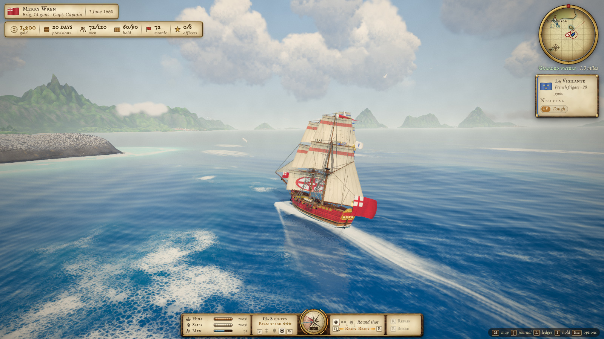
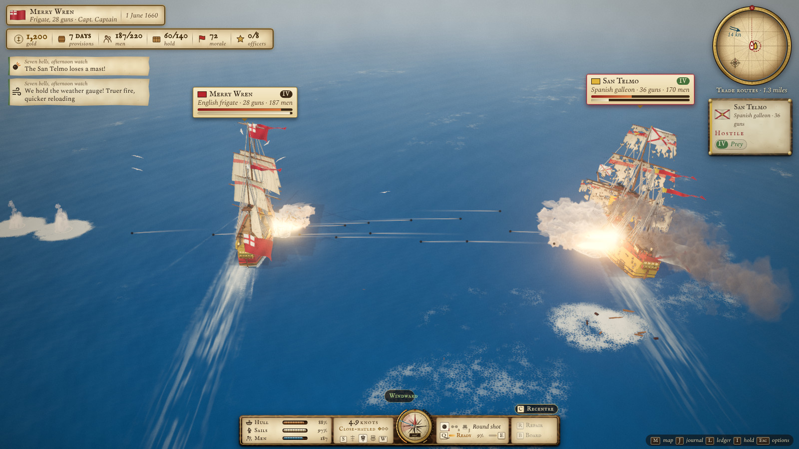
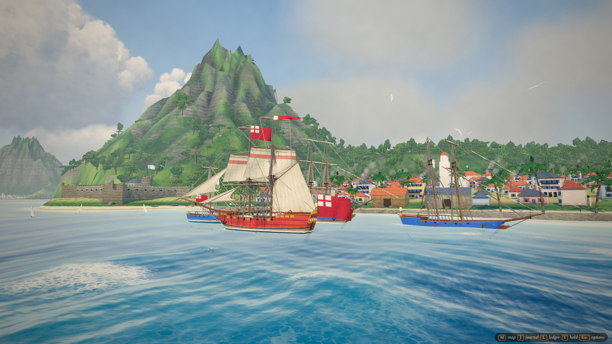
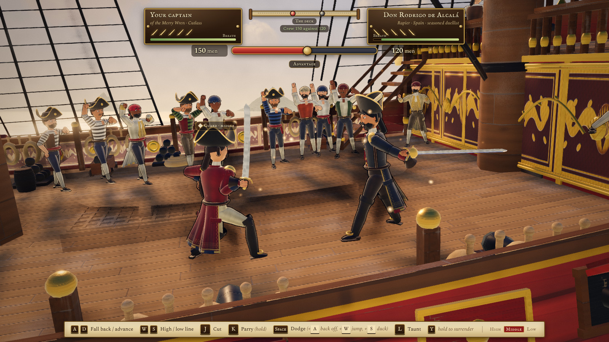
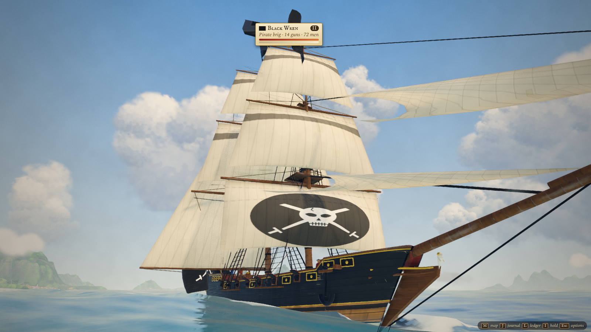

# Tides of Fortune

*[Lire en français](README.fr.md)*

An open-world pirate and privateer game for the browser, set in the 17th-century Caribbean: sailing, naval
battles, boarding and sword duels, ports, trade, governors' missions and a whole career at sea.
Desktop, keyboard and mouse.

**Play it:** https://tides-of-fortune.fr/

https://github.com/user-attachments/assets/08863135-3381-42e2-ba97-17952717541b

*Trailer captured in the game itself (Ultra quality), with its own procedural sound and music.*



## Where it comes from

Did you ever dream of becoming a pirate? I did. A symbol of adventure, freedom, sunshine and a distant age,
piracy brings a world full of stories that never stops fascinating.

As a big fan of 2000s games, I played *Sid Meier's Pirates!*, a game whose very complete world captivated a great
many captains. Time has passed and its graphics have stayed in their era. So why not give this kind of game a new
lease of life, drawing on the latest advances in AI?

The project has two goals:

1. bring this kind of game back with fresh graphics and a complete, playable world;
2. adopt a light technical architecture, so that as many people as possible can play it.

*Tides of Fortune* is an original game: no name, image, music, text or interface is taken from *Pirates!* or from
any other game.

## How it plays

The game is first and foremost a sailing simulation. Aboard your ship, you roam part of the Caribbean Sea. You will meet
sailors from the main nations of the time (Spain, England, France and the Netherlands), pirates and neutral
fishermen, and you can go ashore in ports.

Sailing and naval combat are one and the same: when a fight breaks out, any ship nearby can join it, which can
turn into a free-for-all between several nations… watch out for reinforcements! A broadside fires once every gun
on that side is loaded. And one particularity of this game: your aim has to be judged with care, or your
cannonballs will end up in the sea.

https://github.com/user-attachments/assets/dcaa81e9-d278-4c94-aa01-b538bf6f5134

*A run with the full interface: trimming sail, a fight with a Spanish galleon (round shot, then chain shot),
boarding and the sword duel on deck. Key prompts are shown for a QWERTY keyboard.*

## The world: ships, nations, days and trade

On your voyages you will come across many ship models, sorted into classes (I to V) that give you their estimated
strength at a glance. Each ship has its own characteristics: number of guns, crew, hold, speed, handling,
draught and hull strength. They can be improved with refits at the shipyard: heavier guns, doubled planking,
a deeper hold, copper sheathing, finer canvas, extra hammocks.

Time moves on in the game and the days go by. You can watch superb sunrises and sunsets, but keep an eye on your
provisions: your crew eats every day. Time also counts for the missions you can accept in ports, each of which has
a deadline.

In numbers:

- **27 ship types** in 9 families, from the lugger to the three-decker;
- **36 islands**, **14 ports** under five flags (Spanish, English, French, Dutch and pirate havens) and
  **6 fishing villages**;
- **16 trade goods** whose prices follow supply and demand, town by town;
- nations that go to war, make peace or form alliances as the days pass, convoys and treasure galleons, pirate
  captains ranked in a Top 10, treasure maps to piece together;
- a career with ranks, land grants and a final score when your captain retires.

Away from the open sea, you can also trade, recruit and refit in port, board a ship and fight its captain sword
in hand, take a town by storm with your crew, or slip past the guards of a hostile town by night.

## In pictures

<table>
  <tr>
    <td width="50%"><br><sub>Trading broadsides with a Spanish galleon</sub></td>
    <td width="50%"><br><sub>Fort Royal, a French harbour</sub></td>
  </tr>
  <tr>
    <td width="50%"><br><sub>A sword duel on the deck of a Spanish galleon</sub></td>
    <td width="50%"><br><sub>A pirate brig under full sail</sub></td>
  </tr>
</table>

*Screenshots taken in the game at the Ultra preset.*

## Under the hood

### A light architecture

- **One page, no installation.** The whole game is a single HTML file of about 2 MB (700 kB compressed). It runs in
  the browser with WebGL 2 and needs no plug-in, server or account.
- **Zero asset files.** Ships, sails and rigging, islands, towns, characters, textures, shaders, music and sound
  effects are all generated by code when the game loads. The only external resource is the font sheet from Google
  Fonts.
- **A short stack.** [three.js](https://threejs.org) r186 for 3D rendering and [Vite](https://vite.dev) 8 for the
  build, plain JavaScript modules, no framework. About 150 JavaScript files and 34,000 lines of code.
- **Saves** go to the browser's local storage: automatically when you leave a port and every two minutes at sea.

### Rendering

- **Ocean**: 12 Gerstner waves computed on the GPU, with an exact copy on the CPU. Ships float, heel and pitch on
  the very surface you see. Detail rings around the camera, calmer water in the shallows, foam wakes drawn into a
  texture.
- **Sky and weather**: a full day-night cycle with sunrises, sunsets and starry nights, image-based lighting that
  follows the sky, clouds lit from below at dusk, squalls and storms that drift across the sea, and a wind that
  slowly turns.
- **Islands and towns**: relief baked in parallel by Web Workers during loading, instanced vegetation, procedural
  towns and fortresses cut into 60 m blocks so that only the useful part is drawn into the shadows.
- **Ships**: 27 types built from 6 parametric base designs. Hand-painted planking textures generated per type, wear
  and burn marks, a lighter version of each hull beyond about 200 m.
- **Characters**: skinned procedural figures for duels, crowds and port extras, with seeded faces and an ink
  outline. Port portraits are rendered in 3D, and the paintings in the governor's hall go through a Kuwahara
  filter to look painted.
- **Painterly look**: an HDR pipeline with sun shafts, bloom, ACES tone mapping and a colour grade (canvas grain,
  vignette, split toning), then FXAA, or SMAA and ambient occlusion (GTAO) in Ultra.

### Performance

- Three graphics presets (Performance, Standard, Ultra) and a dynamic resolution that adjusts the image size every
  second to keep the frame rate steady, within a pixel budget per preset (a 4K screen is rendered smaller and
  scaled up).
- The game measures the screen's refresh rate. On a 120–240 Hz screen it can show every second image at an even
  pace when it cannot keep up with all of them (Options → Frame rate).
- The target is 60 fps in 1080p on a mid-range laptop GPU, under 400 draw calls. At sea, the Standard preset draws
  100 to 170 calls and 0.4 to 0.6 million triangles.
- Shaders are compiled ahead of time, in parallel when the GPU allows it, so that a port, a duel or a battle opens
  without stutter.

### Simulation

- **Sailing**: speed curves per rig (square, fore-and-aft or mixed) and per point of sail, leeway, heel, drafts and
  shoals. Deliberately arcade: responsiveness comes before realism.
- **Gunnery**: every cannonball is a real projectile. The guns elevate automatically for the nearest enemy in the
  arc and lead its course, but the ship's roll, the range, the dispersion of each type of shot and the weather
  gauge decide where the ball lands. Round shot smashes the hull, chain shot tears the sails, grapeshot thins out
  the crew. Masts fall, ships strike their colours, magazines explode.
- **AI**: each role has its own temperament. Merchants flee and surrender, patrols and hunters fight for the
  weather gauge, pirates close in, escorts defend their convoy, and everyone steers clear of storms.
- **A living world**: diplomacy, town events (growth, epidemics, raids), markets and convoys are drawn day by day.
  The sea is split into three levels of danger, from the guarded waters of your home port to the perilous seas.
- **Duels, town assaults and infiltration** run on pure simulations, separate from the rendering: a duel with
  lines of attack, parries and stamina, a battle on a 48 × 32 grid built from the island's relief with path
  finding, guards with cones of vision and real cast shadows to hide in.
- **Audio**: synthesised live with the Web Audio API. Melodies are generated from seeds in the modes of each theme
  (sea, battle, storm, tavern of each nation…), plucked strings by physical modelling (Karplus–Strong).
- **Any keyboard**: keys are read by their physical position and labelled with your layout's real letters (W A S
  D on QWERTY, Z Q S D on AZERTY).

### Made with AI

The game was written with Claude (Anthropic), through Claude Code, under the author's direction. The method:

- every system goes through **three rounds of severe critique** on fresh screenshots, with a score per axis, a
  WIN/FAIL verdict and a ranked list of fixes before the next round;
- an **art bible** sets the direction (a painted adventure book), the palette and the performance budget;
- **16 showcase scenes** (`?shot=`) frame each system for screenshots, and **22 scripted tests** (Playwright and
  Node) play the game to check sailing, combat, duels, missions, the economy and more;
- performance tools measure the triangles and draw calls of each system, the loading steps and the cost of each
  transition.

## Run it locally

You need [Node.js](https://nodejs.org) 20 or later (LTS) and Git.

```sh
git clone https://github.com/silvestroz/tides-of-fortune.git
cd tides-of-fortune
npm install
npm run dev
```

Then open **http://127.0.0.1:5173** in Chrome or Edge. Hot reload is off: reload the page after a change.

On Windows, if PowerShell refuses to run `npm` (“running scripts is disabled on this system”), run
`Set-ExecutionPolicy -Scope CurrentUser RemoteSigned` once, or use the Command Prompt (`cmd`).

### Build a single file

```sh
npm run build
```

This writes `dist/tides-of-fortune.html` (about 2 MB), a self-contained file that runs without a server.

## Controls

Keys are listed by their position on a QWERTY keyboard. The game reads the physical key and shows the letter of
your own layout on screen (on AZERTY, W A S D appear as Z Q S D). The full list is under **Controls** on the
title screen.

| At sea | Keys |
|---|---|
| Make or shorten sail | W / S |
| Helm | A / D |
| Port / starboard broadside | Q / E |
| Fire at the nearest enemy | Space |
| Round shot / chain shot / grapeshot | 1 / 2 / 3 |
| Board a weakened enemy alongside | B |
| Emergency repairs (heave to first) | R |
| Hold: throw goods or guns overboard | I |
| Strike your colours | X twice |
| Camera · recentre in combat | C |
| Speed up time | T |
| Fire at will / cease fire (Assisted mode) | G |
| Enter port · land at a fishing village · dig for treasure | F |
| Attack a town · organise an attack from a haven | V |
| Map / Ledger / Journal | M / L / J |
| Pause and options | Esc |

| In a duel | Keys |
|---|---|
| Fall back / advance | A / D |
| High / low line (neither = middle) | W / S |
| Cut / parry (hold) | J / K |
| Dodge (with a direction: back off, jump, duck) | Space |
| Taunt / surrender (hold) | L / Y |

Town assaults are played with the mouse (select and order companies) and W A S D for the camera; infiltrations
with W A S D, Shift to run and Space to pick a lock.

## Saving, time and graphics

- **Saving** is automatic when you leave a port, after a prison stay, a shipwreck or a battle, and every two
  minutes at sea outside combat. Esc → Save saves by hand at sea. There is one game per browser.
- **Time**: one calendar day is one day-night cycle, four real minutes (T speeds up both). A full career, from
  your first command to retirement, lasts 12 to 18 hours of play.
- **Graphics**: Options → Graphics offers Performance, Standard and Ultra (applied on reload). F3 shows the frame
  rate, screen refresh rate and rendering cost; Shift+F3 copies those details, to paste in a bug report.
- **Statistics**: in production, the game counts a few anonymous milestones (loading time, first steps, frame
  rate, errors) as page views through Vercel Web Analytics. Nothing is sent with Do Not Track or Global Privacy Control,
  and Options → Statistics turns it off.

## URL parameters

| Parameter | Effect |
|---|---|
| `?quality=low` / `medium` / `high` / `ultra` | graphics tier (default `high`) |
| `?shot=<scene>` | open a showcase scene: `ocean`, `sky`, `weather`, `ships`, `islands`, `sailing`, `combat`, `hud`, `port`, `village`, `duel`, `worldmap`, `sealife`, `landbattle`, `sneak`, `overview` |
| `?tod=17.5` | fixed time of day |
| `?weather=clear` / `cloudy` / `storm` | fixed weather |
| `?sealife=dolphins` | spawn sea life (`dolphins`, `whale`, `flyfish`, `turtle`, `ray`, `bait`) |
| `?start=<port id>` | start port (default Port Royal) |

## Project layout

| Folder | Contents |
|---|---|
| `src/core` | game loop, input, keyboard layouts, post-processing, quality tiers |
| `src/world` | ocean, sky and weather, islands and terrain, vegetation, towns, sea life |
| `src/ships` | procedural ship models, sailing physics, player controls, AI |
| `src/combat`, `src/fx` | broadsides, damage, sinking, visual effects |
| `src/game` | ports, economy, career, missions, saving, boarding, duels, town assaults, infiltration |
| `src/data` | tuning tables (ship types, missions, zones, items…) |
| `src/ui` | HUD, menus, port screens, world map |
| `src/audio` | procedural sound and music (Web Audio) |
| `src/shots` | showcase scenes (`?shot=`) |
| `tools` | build, screenshots, scripted tests, performance tools |
| `docs` | art bible, critique protocol and reports |

The scripted tests (`node tools/test-*.mjs`) and screenshot tools use Playwright: run
`npx playwright install chromium` the first time.

## Credits

- Fonts: [IM Fell English](https://fonts.google.com/specimen/IM+Fell+English) and IM Fell English SC by Igino
  Marini, [Spectral](https://fonts.google.com/specimen/Spectral) by Production Type, all under the SIL Open Font
  License, served by Google Fonts.
- [three.js](https://threejs.org) for 3D rendering, [Vite](https://vite.dev) for the build, the Web Audio API for
  sound.

*Tides of Fortune* is an independent project. It is not affiliated with or endorsed by the creators or publishers
of *Sid Meier's Pirates!*; all trademarks belong to their respective owners.

## Licence

Tides of Fortune is released under the [PolyForm Noncommercial License 1.0.0](LICENSE.md). You may play, study,
modify and share the game and its code for any noncommercial purpose: personal use, research, teaching, hobby
projects, charities and public institutions. Selling it, or using it in a commercial product or service, needs
separate permission from the author.

The fonts, three.js and the other libraries keep their own licences.
